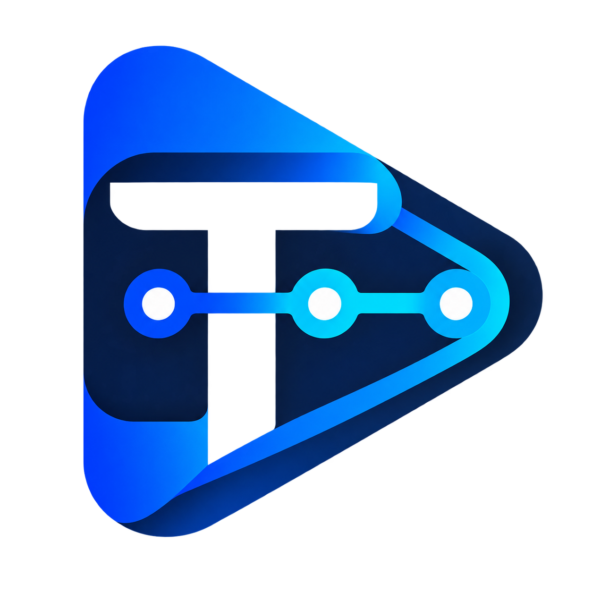

<p align="center">
  
</p>

# TubeAiFolw

TubeAiFolw is a local-first AI production workflow for long-form YouTube and faceless
video creators. During development it runs as a Vue Web UI plus a local FastAPI Engine.
The project workflow is the primary product surface; segmented voice generation, local
video merging, voice profiles, and digital-human synthesis remain available as compatible
tools while they are progressively integrated into project-level workflows.

Current voice-generation workflow:

1. Select a saved voice profile and enter an output WAV filename.
2. Paste the transcript with one desired TTS segment per line.
3. Click **Generate Voice**. Blank lines are ignored; punctuation and text length never
   create additional segments.
4. The selected engine generates each line in order. IndexTTS, MOSS-TTS, CosyVoice,
   and Qwen3-TTS all use this same segmented workflow.
5. FFmpeg merges the generated WAV files in their original order.
6. The page retains and exposes both the individual segment WAVs and the complete WAV.

Each voice-generation task has a random UUID (32 hexadecimal characters), shown in
generation history with a copy button. Search history by this ID, or search
`backend/workspace/logs/engine.log` and the task's `logs/*.log` files for
`[task_id=<ID>]`. The same ID is retained across pause/resume and restart recovery;
new submissions receive new IDs. Queue events, nested Engine logs, runner output,
and audio merging share this ID. Copying an error also includes the task ID.
Existing records keep their original IDs; logs written before this feature are
not retroactively tagged. Paths above use the default workspace directory.

For an output filename such as `人物开场白.wav`, artifacts are stored as:

```text
backend/workspace/voice_generations/{task_id}/
  人物开场白.wav
  segments/
    人物开场白_0001.wav
    人物开场白_0002.wav
  segments.json
  logs/
```

## Local URLs

- Frontend: http://127.0.0.1:5173
- Backend: http://127.0.0.1:18080

## Windows double-click start

From the project root, double-click:

- `Start_TubeAIFlow.bat` to start the backend and frontend (legacy-compatible filename)
- `Start_TubeAIFlow.bat --restart` / `--stop` to restart / stop local services
- `Start_TubeAIFlow.bat --check` for a read-only environment check
- `Start_TubeAIFlow.bat --repair` to rerun dependency installation
- `Restart_TubeAIFlow.bat` to stop the running app, then start again
- `Start_TTS_WebUI.bat index_tts|moss_tts|cosyvoice` to run one engine's standalone WebUI

The BAT files are compatibility entry points; shared startup logic lives in
`scripts/Launch_TubeAiFolw.ps1`. The standalone TTS entry remains available for
existing integrations and delegates to `scripts/Start_TTSWebUI.ps1`.

Create a desktop shortcut with the project Logo by running:

```powershell
powershell.exe -NoProfile -ExecutionPolicy Bypass -File scripts/Create_DesktopShortcut.ps1
```

This converts the existing Logo to a multi-resolution ICO and creates `TubeAiFolw.lnk`
on the current user's desktop. The shortcut starts minimized and points to the project;
do not copy the BAT itself to the desktop. Rerun this command after moving the repository.

The start script uses the existing backend virtual environment without requiring a
system-wide Python on `PATH`. If the environment does not exist, Python 3.12 is required
once to create it. On the first run of the updated launcher, dependencies are checked by
pip/npm once and fingerprints are saved inside `.venv` and `node_modules`. Subsequent
starts skip installation unless the dependency files change or `--repair` is supplied.
The launcher waits up to 90 seconds for backend health and frontend HTTP readiness before
opening the browser. Concurrent launcher invocations are serialized, and a healthy running
instance is reused. The launcher starts both services in
the background. It records both process IDs and writes rotating Engine logs plus backend
and frontend process output to `backend/workspace/logs`. Restart
uses the recorded process trees plus listener ports, so the previous instance is stopped
before new processes are created.
Backend runtime configuration is loaded from the local SQLite system settings table.

## Backend

```powershell
cd backend
python -m venv .venv
.\.venv\Scripts\Activate.ps1
pip install -r requirements.txt
python -m app.run
```

`requirements.txt` remains the full Windows local-AI installation. Environments that only
need the Engine and cloud Providers can install `requirements-core.txt`; local CUDA models
and TTS/ASR integrations are split into `requirements-local-ai-cu128.txt` and
`requirements-tts-asr.txt`.

## Frontend

```powershell
cd frontend
npm install
npm run dev
```

## Checks

```powershell
cd backend
pip install -r requirements-dev.txt
pytest -q
ruff check app tests

cd ..\frontend
npm test
npm run build
```

## Semantic visual-enrichment AI models

The visual-enrichment pipeline supports both deterministic dry runs and real local AI
inference. Models are stored by responsibility instead of being mixed in one directory:

```text
models/
  llm/qwen3-8b-q4_k_m/                 # semantic analysis through llama.cpp
  embedding/bge-m3-onnx/               # CPU semantic embeddings
  image_generation/flux2-klein-4b-fp8/ # diffusion, text encoder, and VAE subfolders
  vision/qwen3-vl-4b-instruct-bf16/    # generated-image quality control on Windows
```

Download and checksum the pinned official model revisions, then install the two local
model servers:

```powershell
backend\.venv\Scripts\python.exe scripts\download_visual_models.py
backend\.venv\Scripts\python.exe scripts\install_llama_cpp.py
backend\.venv\Scripts\python.exe scripts\install_comfyui.py
```

The RTX 5060 Ti profile permits only one large GPU workload. Start semantic analysis or
image generation as needed and stop it before switching to the other service:

```powershell
backend\.venv\Scripts\python.exe scripts\start_visual_model_service.py semantic
backend\.venv\Scripts\python.exe scripts\start_visual_model_service.py image
```

Run the real stages serially: use the semantic service for `--stage semantic`, stop it;
use the image service for `--stage generate`, stop it; then run `--stage qc` to load
Qwen3-VL directly. The CPU-only plan and timeline stages need no model service. These
providers are configured in `config/production_5060ti.yaml`.
The FLUX.2 API workflow is `workflows/flux2_klein_scene_api.json`; ComfyUI reads the
three image-model component types through `config/comfyui_extra_model_paths.yaml`.

For a deterministic pipeline check that loads no model, use:

```powershell
python run.py `
  --project tests/fixtures/demo `
  --config config/production_5060ti.yaml `
  --dry-run
```

Run one stage with `--stage ingest|semantic|plan|generate|qc|timeline|render`. Use
`--resume` to reuse SHA256-verified artifacts or `--force` to rebuild current artifacts.
Provider generations remain append-only in the project's `work/pipeline.db`.

## Notes

- Runtime configuration is managed on the **System Settings** page and stored locally in SQLite.
- IndexTTS uses `D:\index-tts\python310`; MOSS-TTS and CosyVoice use their own isolated
  environments. Qwen3-TTS remains compatible with the existing backend environment.
- API keys are never returned to the frontend after they are saved.
- Generated voice files live under `backend/workspace/voice_generations/{task_id}` by default.
- FFmpeg, ffprobe, all four TTS engines, workspace, host, and port are configured on the System Settings page.
- On Windows 10/11 64-bit, the System Settings page can automatically download the latest FFmpeg release essentials build, verify its published SHA-256 checksum, install only `ffmpeg.exe` and `ffprobe.exe` under `workspace/tools/ffmpeg`, and save both absolute paths to SQLite. The downloaded tools are local runtime files and are not committed to Git.
- The automatic FFmpeg installer uses the Windows builds linked by the FFmpeg project and currently downloads the GPLv3 Gyan essentials build from `https://www.gyan.dev/ffmpeg/builds/`.
- Qwen3-TTS voice cloning works best when the voice profile includes an accurate transcript of the reference audio. Without it, TubeAiFolw automatically uses speaker-embedding-only mode.
- CosyVoice uses zero-shot cloning and requires an exact transcript of the reference audio. Fun-CosyVoice 3 prompt formatting is handled automatically.
- Host and port changes take effect after restarting the app.
